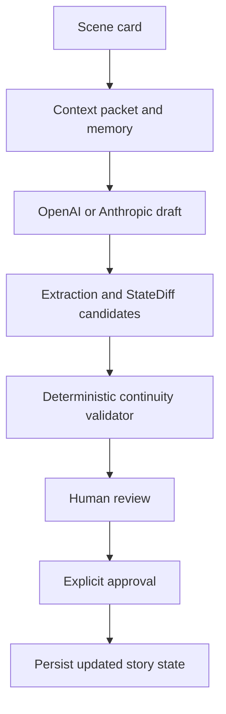

# EMBER — Stateful AI writing studio

A scene-based writing environment for long-form fiction. The technical focus is persistent story state, deterministic continuity checks and explicit human approval of proposed changes.

**[Open the public reader](https://ember-story.vercel.app/)** · [Private author studio](https://ember-story.vercel.app/studio/)

The reader is public. The studio, project data and generation endpoints require the author's credentials. Recruiters can inspect the implementation and run the deterministic checks without provider accounts.

## What is implemented

- Next.js 15, React 19 and TypeScript application with a Supabase persistence layer.
- Scene cards distinguish hard continuity constraints from soft writing guidance.
- Context packets combine canon, character state and open threads for a scene.
- OpenAI/Anthropic draft generation, length checks, extraction, continuity validation and quality warnings.
- Typed StateDiff approval/rejection: proposed canon changes require explicit review.
- Human Edit Memory records how accepted text was subsequently edited.
- A branching-fiction reader with browser-local progress under `public/legacy/`.

## What is partial

The schema supports object, knowledge and promise ledgers. Automatic extraction currently fills object/character/canon candidates; `buildStateDiffFromExtraction` still returns empty `knowledgeChanges` and `promiseUpdates`. The validator and approval code handle supplied entries, but the automatic knowledge/promise extraction is not complete.

A successful type check or deterministic test does not establish prose quality, provider availability or a complete live generation flow. This is a single-author tool, not a multi-tenant writing SaaS.

## Architecture



Remote generation and database access live in `lib/server/`. The state validator in `lib/book-state-validator.ts` makes no network calls. The public reader uses bundled fictional examples rather than the private studio database.

## Run checks without secrets

Use Node.js 24:

```bash
npm ci
npm run test:book-state
npm run test:studio-auth
npm run typecheck
```

The existing StateDiff suite also exercises prompt/context construction and acceptance guards. Authentication tests cover missing configuration, missing/wrong credentials, the studio/API boundary and the separate cron path. GitHub Actions runs these checks without production credentials.

## Run the app

```bash
cp .env.example .env.local
# Fill in your own Supabase configuration and studio password.
npm run dev
```

The public reader is at `http://localhost:3000/`; the private studio is at `/studio/`. Apply the migrations in `supabase/migrations/` to your own Supabase project before using persistence.

| Configuration | Purpose |
| --- | --- |
| `NEXT_PUBLIC_SUPABASE_URL`, `NEXT_PUBLIC_SUPABASE_ANON_KEY` | Public client configuration |
| `SUPABASE_SERVICE_ROLE_KEY` | Server-only access to the single-author workspace |
| `STUDIO_USERNAME` | Studio login name; defaults to `studio` |
| `STUDIO_PASSWORD` | Required private studio password; use a long unique value |
| `OPENAI_API_KEY` and/or `ANTHROPIC_API_KEY` | Optional for remote generation |
| `CRON_SECRET` | Separate credential for keepalive and database health checks |

Provider/model choices are defined in `.env.example` and the server modules. GPU/local-model experiments are optional and are not required for the deterministic tests.

## Access boundary

The private studio uses HTTP Basic authentication over HTTPS. Middleware protects `/studio` and `/api`; data and generation handlers check the same credential again before invoking services. Missing password configuration denies access. Cron endpoints retain their own bearer-secret checks. The shared credential intentionally grants access to one trusted author workspace; it is not a substitute for per-user ownership checks in a future multi-user product.

Configure the password as a server-side Vercel secret, never as a `NEXT_PUBLIC_` value. Rotate it in Vercel if disclosed. The password is not included in this repository. Build/deployment requires the real Supabase configuration; do not substitute production credentials in CI.

```bash
npm run build
vercel deploy --prod
```

## Code map

| Area | Entry point |
| --- | --- |
| Studio UI | `components/studio/studio-workspace.tsx` |
| Persistent story operations | `lib/server/studio-story-service.ts` |
| Draft orchestration | `lib/server/book-job-service.ts` |
| State validation and approval | `lib/book-state-validator.ts` |
| State types and normalization | `lib/story-schema.ts` |
| Studio access checks | `lib/server/studio-auth.ts`, `middleware.ts` |
| Database setup | `supabase/migrations/` |
| Public example reader | `public/legacy/` |

## Repository status

The source is published for portfolio review. No project-wide open-source license file is currently included; third-party packages, model services and creative assets have their own terms. Demo fiction is example content, not a benchmark proving general writing quality.
